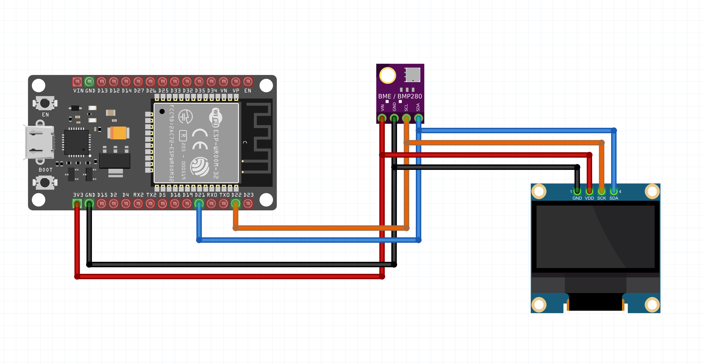
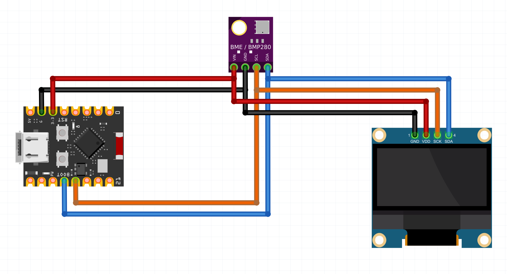

# 🌦️ DLS Weather Node

[](https://github.com/sponsors/Deeplab-Studio)

Community-driven weather nodes for the **DLS Weather** network. One API call publishes the same
measurement to up to five services:

- 📡 **APRS Weather Station** (amateur radio)
- 🌍 **PWSWeather**
- ☁️ **WeatherCloud**
- 🌡️ **Weather Underground**
- 🌬️ **Windy.com**

Firmware version is defined once in [`include/version.h`](include/version.h) and reused by the web
installer manifests.

---

## 🔌 Supported hardware

### Boards

| Board | Chip | Environment | Status | Notes |
| :--- | :--- | :--- | :---: | :--- |
| **ESP32-WROOM / DevKit** | ESP32 | `esp32_wroom` | ✅ tested | Full feature set, wind + rain included |
| **ESP32-C3 SuperMini** | ESP32-C3 | `esp32c3_super_mini` | ✅ tested | Compact / low power, I2C sensors only |
| **ESP32-S3 SuperMini** | ESP32-S3 | `esp32s3_super_mini` | 🟡 new | 4 MB flash, I2C + wind + rain, RGB LED |

> Wind and rain pins are only defined for boards where they exist in `variant.h`. On the C3 the
> corresponding pages are skipped automatically instead of showing empty `NaN` screens.

### Pin map (per board, edit `variants/<board>/variant.h`)

| Signal | ESP32-WROOM | ESP32-C3 SuperMini | ESP32-S3 SuperMini |
| :--- | :--- | :--- | :--- |
| I2C SDA / SCL | 21 / 22 | 8 / 9 | 4 / 5 |
| Sensor power (MOSFET) | 4 | 10 | 6 |
| Battery ADC | 34 | 3 | 1 |
| Wind direction (ADC) | 35 | – | 2 |
| Wind speed (pulse) | 14 | – | 7 |
| Rain gauge (pulse) | 27 | – | 8 |
| Status LED | 2 | – | 48 (WS2812) |

`ADC_MULTIPLIER` defaults to `1.6667` for a 1 MΩ + 1.5 MΩ divider (3.0–4.2 V Li-ion).

### Sensors

| Sensor | Bus | Measures | Notes |
| :--- | :--- | :--- | :--- |
| **BME680** | I2C 0x76/0x77 | Temp, humidity, pressure, gas | Auto-detected first (gas → IAQ in kΩ) |
| **BME280** | I2C 0x76 | Temp, humidity, pressure | |
| **BMP280** | I2C 0x76 | Temp, pressure | |
| **SHT30/SHT31/SHT35** | I2C 0x44/0x45 | Temp, humidity | |
| **SHTC3** | I2C | Temp, humidity | |
| **VEML6075** | I2C | UV index | |

Detection order is BME680 → SHT3x → SHTC3 → BME280 → BMP280; the first responder wins and is printed
on the serial log and on the device screen. Only one air sensor is used at a time.

### Displays

| Controller | Size | Interface |
| :--- | :--- | :--- |
| **SSD1306** | 0.96"/1.3" OLED | I2C |
| **SH1106** | 1.3" OLED | I2C |

If no display is found the firmware runs headless.

### Wiring

**ESP32-WROOM**



**ESP32-C3 SuperMini**



---

## 🚀 Build & flash

Requires [PlatformIO](https://platformio.org/).

```bash
pio run -e esp32_wroom            # classic ESP32
pio run -e esp32c3_super_mini     # C3 SuperMini
pio run -e esp32s3_super_mini     # S3 SuperMini
pio run -e esp32s3_super_mini -t upload
```

Each build copies `bootloader.bin`, `partitions.bin` (and `boot_app0.bin` when the partition table
has an `otadata` section) plus `firmware.bin` into `docs/firmware/<env>/` and regenerates
`manifest.json` / `manifest_update.json` for the web installer.

Browser installer: **https://deeplab-studio.github.io/DLS-Weather-Node/**

- **Full install** – erases flash, then configure over USB.
- **Update only** – writes `firmware.bin` at `0x10000`, keeps Wi-Fi/API settings.

---

## 🔑 Getting an API key

1. Register: <https://wx.deeplabstudio.com/register>
2. Open **API Keys**: <https://wx.deeplabstudio.com/dashboard/api-keys>
3. Press **+ Generate Key** and copy the value.

Then provision the node either from the web installer (USB) or from the device's own web UI.

---

## 🖥️ Device web UI

Once the node is on Wi-Fi it serves a small local UI (no internet needed, no CDN):

```
http://dls-weather-<station>.local     # mDNS
http://<device-ip>/
```

- **PIN protected.** A 6-digit PIN is generated on first boot, stored in NVS and shown on the OLED
  startup screen, on the `NETWORK` page and in the serial boot log (`pin` command reprints it).
- 5 wrong PINs trigger a 60-second lockout; the session cookie lasts 12 hours.
- `Host` header is validated (IP or `*.local`) and cross-origin `POST`s are rejected, which blocks
  DNS-rebinding/CSRF attempts from web pages.
- Secrets are never echoed back: leave the password/API-key field empty to keep the stored value.

Endpoints (all behind the PIN session):

| Endpoint | Description |
| :--- | :--- |
| `GET /` | Status + settings page |
| `POST /save` | Validate and store settings, then restart |
| `GET /api/weather` | Latest measurement as JSON |
| `GET /api/status` | Firmware version, uptime, RSSI, heap, sensor list |
| `POST /restart` | Reboot the device |

### Serial console (115200 baud)

| Command | Effect |
| :--- | :--- |
| `GET_CONFIG` | Dump full config as JSON (used by the installer) |
| `GET_CONFIG MASKED` | Same, with password / API key masked |
| `SET_CONFIG {json}` | Validate, store, restart (`CONFIG_SAVED` or `VALIDATION_ERROR ...`) |
| `info` | Print current settings (secrets masked) |
| `pin` | Reprint the web PIN |
| `restart` | Reboot |

Serial access requires physical USB access and is treated as a trusted channel; the web UI is the
network-facing surface and is PIN protected.

---

## ⚡ Power behaviour

- **Deep sleep off** – node stays online, publishes every *interval* minutes.
- **Deep sleep on** – publish, then sleep for exactly one interval. A 5-minute configuration window
  opens on a cold boot (not on timer wake-ups) so the web UI stays reachable.
- Failures retry three times at 60 s, then the node waits for the next interval (with deep sleep it
  goes back to sleep instead of staying awake).
- Rain "daily" total survives reboots and deep sleep (stored in NVS) and resets when the UTC day
  (NTP epoch day) changes.
- Battery voltage is averaged over 8 ADC samples; the percentage is shown in the screen footer and
  in the web UI.

---

## 🔗 Using the DLS Weather API in other projects

```
POST https://wx-api.deeplabstudio.com/v1/ingest/weather
Content-Type: application/json
x-api-key: <your key>
```

```json
{
  "stationId": "ST-E9F9AF",
  "timestamp": 1769449600,
  "location": { "lat": 41.0082, "lon": 28.9784 },
  "environment": {
    "temperature": 22.5,
    "humidity": 60,
    "pressure": 1013,
    "uv_index": 3.5,
    "air_quality": 45
  },
  "wind": { "speed": 5.2, "direction": 180 },
  "rain": { "rate": 0, "daily": 2.5 },
  "power": { "battery": 85, "voltage": 4.1, "solar": 5.2 }
}
```

Every section is optional; the firmware only sends fields it actually measured.

---

## 🔒 Security notes

- The configuration UI is HTTP on the local network. It is PIN protected and hardens headers
  (`CSP`, `nosniff`, `no-referrer`, `no-store`), but traffic is not encrypted — do not expose port 80
  to the internet.
- Input is validated on every write path (web form and serial JSON share the same rules): string
  lengths, `lat`/`lon` ranges, station-ID character set, interval and TX-power whitelist.
- The device hostname is derived from the station ID with a whitelist of `[a-z0-9-]`.
- **Known limitation:** the `DLS-Weather` library used for uploads calls
  `WiFiClientSecure::setInsecure()`, so the API key is sent over an unvalidated TLS connection.
  Pinning the server CA (`setCACert` / `esp_crt_bundle`) in that library is the recommended next step.
- There is no AP/captive-portal fallback: if Wi-Fi credentials are wrong, recover over USB serial.

---

## 📁 Repository layout

```
src/
  main.cpp                 scheduling, sensor reads, upload, deep sleep
  Config/                  NVS settings, validation, serial console
  Sensor/                  I2C auto-detect, wind/rain ISR, rain daily reset
  Display/                 OLED pages (skips missing sensors)
  NetworkManager/          Wi-Fi, NTP, mDNS, TX power, LED
  WebUI/                   PIN-protected UI + JSON API (HTML in PROGMEM)
variants/<board>/          variant.h pin map + PlatformIO env
include/version.h          single firmware version source
docs/                      GitHub Pages web installer + prebuilt binaries
```

---

## 🤝 Contributing

Issues and pull requests are welcome. Please keep `pio run` green for all three environments and
update the pin table when adding a board.

📡 **DLS Weather — Community Powered Weather Data Network**
