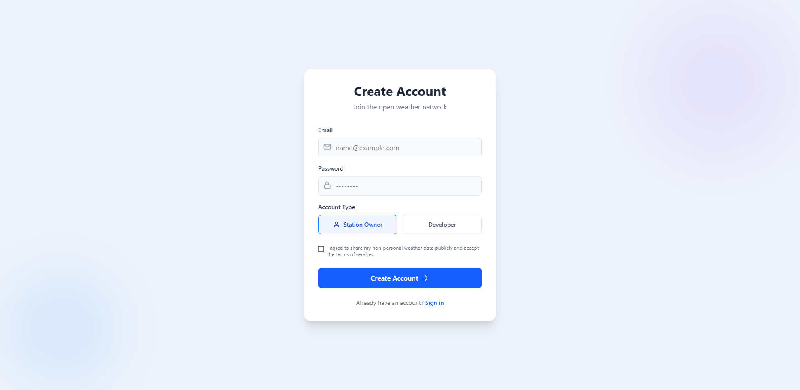
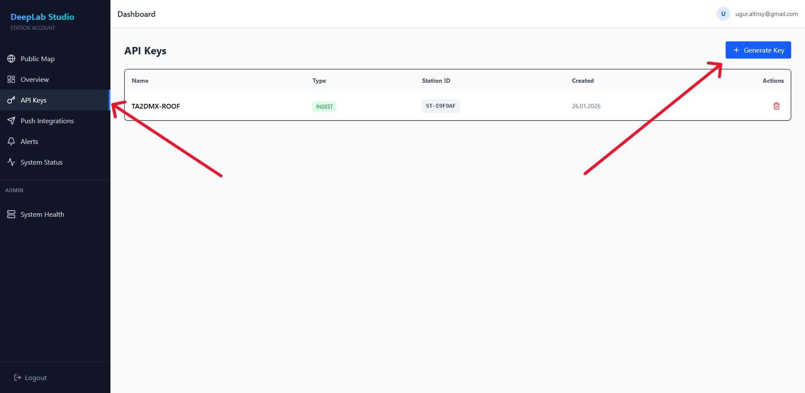
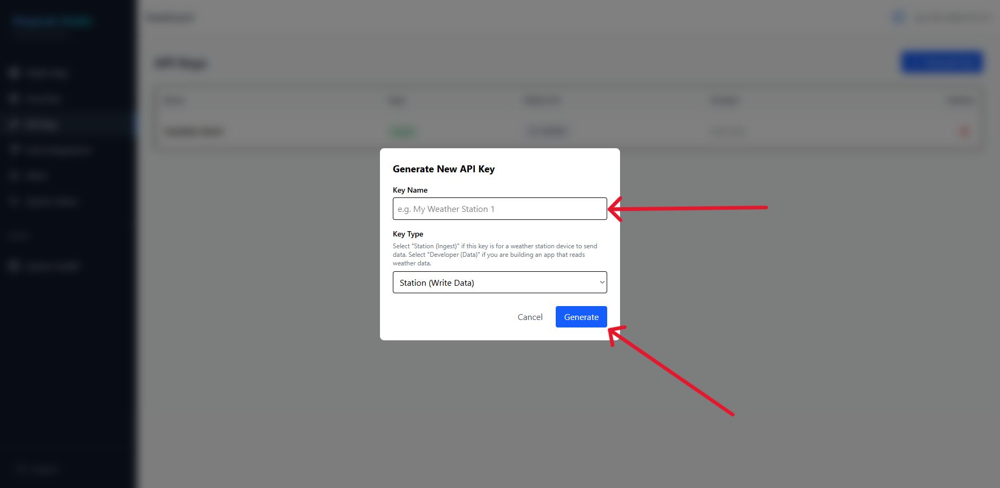
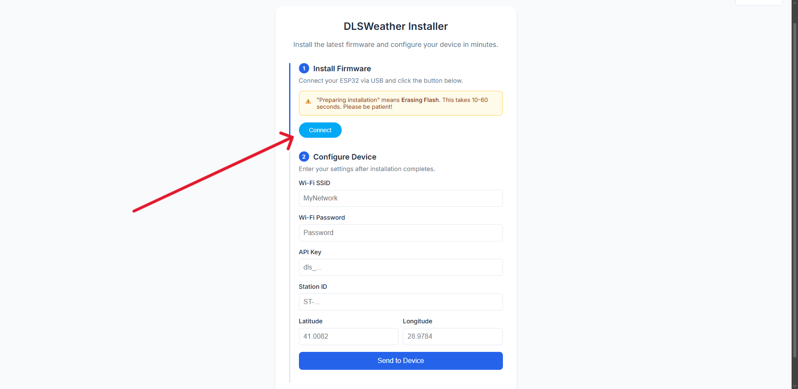
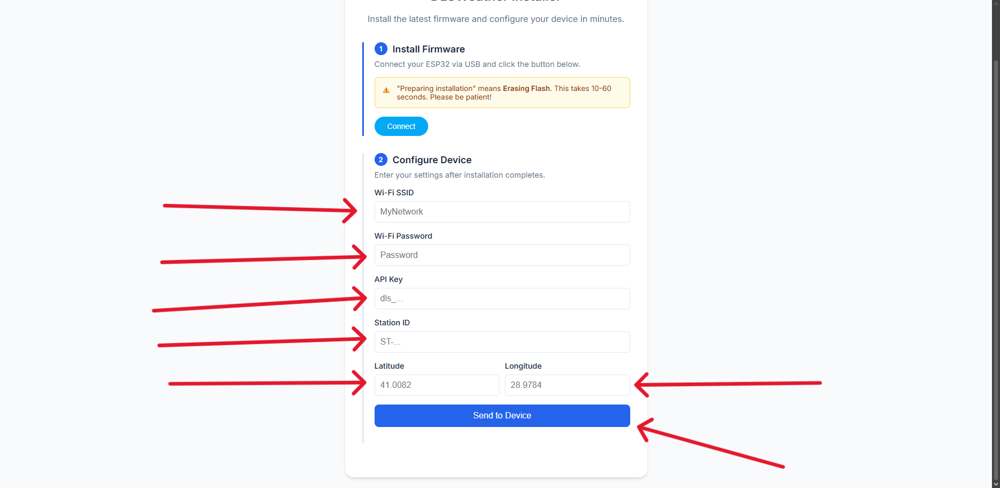

# 🌦️ DLS Weather Node

[](https://github.com/sponsors/Deeplab-Studio)

Türkçe doküman: **[TR-README.md](TR-README.md)**

The purpose of this project is to support the **DLS Weather** initiative by enabling the deployment of **community-driven weather nodes**.

With this service, collected weather data can be transmitted **for free to up to 5 different platforms simultaneously** through a **single API**.

Supported platforms:

- 📡 **APRS Weather Station** (for amateur radio operators)
- 🌍 **PWSWeather**
- ☁️ **WeatherCloud**
- 🌡️ **Weather Underground**
- 🌬️ **Windy.com**

Firmware version is defined once in [`include/version.h`](include/version.h) and reused by the web installer manifests.

---

## 🔌 Supported Hardware

The DLS Weather Node is designed to work with various ESP32 boards, sensors, and displays. Below is the list of supported and tested hardware.

### 📟 Supported Devices

| Device Name | Chip | Environment | Notes |
| :--- | :--- | :--- | :--- |
| **Standard ESP32** | ESP32-WROOM | `esp32_wroom` | Classic ESP32, full feature set |
| **SuperMini ESP32-C3** | ESP32-C3 | `esp32c3_super_mini` | Recommended board (low power, compact) |
| **SuperMini ESP32-S2** | ESP32-S2 | `esp32s2_super_mini` | 4 MB flash, native USB, wind + rain pins |
| **SuperMini ESP32-S3** | ESP32-S3 | `esp32s3_super_mini` | 4 MB flash, RGB LED, wind + rain pins |
| **DevKitC ESP32-S3** | ESP32-S3 | `esp32s3_devkit` | 8 MB flash, more free GPIOs |

### 🌡️ Supported Sensors

| Sensor | Type | Measurements |
| :--- | :--- | :--- |
| **BMP280** | I2C | Temperature, Pressure |
| **BME280** | I2C | Temperature, Humidity, Pressure |
| **BME680** | I2C | Temperature, Humidity, Pressure, Gas (IAQ) |
| **SHT31** | I2C | Temperature, Humidity |
| **SHTC3** | I2C | Temperature, Humidity |
| **SHT35** | I2C | Temperature, Humidity |
| **VEML6075** | I2C | UV Index |
| **BH1750** | I2C | Light Level (planned) |

Detection order is BME680 → SHT3x → SHTC3 → BME280 → BMP280; the first responder wins and is printed
on the serial log and on the device screen. Only one air sensor is used at a time.

### 📺 Supported Displays

| Display Controller | Size | Interface |
| :--- | :--- | :--- |
| **SSD1306** | 0.96" / 1.3" OLED | I2C |
| **SH1106** | 1.3" OLED | I2C |

If no display is found the firmware runs headless.

### 🔌 Pin Map

| Signal | ESP32-WROOM | ESP32-C3 | ESP32-S2 | ESP32-S3 SuperMini | ESP32-S3 DevKitC |
| :--- | :--- | :--- | :--- | :--- | :--- |
| I2C SDA / SCL | 21 / 22 | 8 / 9 | 33 / 35 | 4 / 5 | 8 / 9 |
| Sensor power (MOSFET) | 4 | 10 | 18 | 6 | 7 |
| Battery ADC | 34 | 3 | 1 | 1 | 1 |
| Wind direction (ADC) | 35 | – | 2 | 2 | 2 |
| Wind speed (pulse) | 14 | – | 16 | 7 | 3 |
| Rain gauge (pulse) | 27 | – | 17 | 8 | 4 |
| Status LED | 2 | – | 15 | 48 (WS2812) | 48 (WS2812) |

`ADC_MULTIPLIER` defaults to `1.6667` for a 1 MΩ + 1.5 MΩ divider (3.0–4.2 V Li-ion). Boards without
wind/rain pins skip those readings and their OLED pages automatically.

### ESP32 Wroom 32


### SuperMini ESP32-C3


---

## 🚀 Build & Flash

Requires [PlatformIO](https://platformio.org/).

```bash
pio run -e esp32_wroom            # classic ESP32
pio run -e esp32c3_super_mini     # C3 SuperMini
pio run -e esp32s2_super_mini     # S2 SuperMini
pio run -e esp32s3_super_mini     # S3 SuperMini
pio run -e esp32s3_devkit         # S3 DevKitC-1

pio run -e esp32c3_super_mini -t upload
```

Each build copies `bootloader.bin`, `partitions.bin` (and `boot_app0.bin` when the partition table has
an `otadata` section — see `copy_firmware.py`) plus `firmware.bin` into `docs/firmware/<env>/` and
regenerates `manifest.json` / `manifest_update.json` for the web installer.

Browser installer: **https://deeplab-studio.github.io/DLS-Weather-Node/**

- **Full install** – erases flash, then configure over USB.
- **Update only** – writes `firmware.bin` at `0x10000`, keeps Wi-Fi/API settings.

---

## 🔑 Getting an API Key

### [1️⃣ Step – Register](https://wx.deeplabstudio.com/register)



### [2️⃣ Step – Go to the API Keys Page](https://wx.deeplabstudio.com/dashboard/api-keys)



### 3️⃣ Step – Generate a New Key

Click on the `+ Generate Key` button.


### 4️⃣ Step – Copy the API Key

Copy and securely store your generated API key.


---

## [⚙️ Installing DLS Weather Node on ESP32](https://deeplab-studio.github.io/DLS-Weather-Node/)

### [1️⃣ Step – Open the Installer](https://deeplab-studio.github.io/DLS-Weather-Node/)



### 2️⃣ Step – Connect and Install

- Click **Connect**
- Select **Install DLSWeather**
  

### 3️⃣ Step – Configure Settings

After installation, configure:

- Wi-Fi credentials
- API key, station ID, coordinates
- Sensor settings
  

### [4️⃣ Step – Verify on the Website](https://wx.deeplabstudio.com/)

You can monitor your node from the web dashboard.

---

## 🖥️ Device Web UI

Once the node is on Wi-Fi it serves a small local UI (no internet needed, no CDN):

```
http://<device-ip>/
```

- **PIN protected.** A 6-digit PIN is generated on first boot, stored in NVS and shown on the OLED
  startup screen, on the `NETWORK` page and in the serial boot log (`pin` command reprints it).
- 5 wrong PINs trigger a 60-second lockout; the session cookie lasts 12 hours.
- `Host` header is validated and cross-origin `POST`s are rejected, which blocks
  DNS-rebinding/CSRF attempts from web pages.
- Secrets are never echoed back: leave the password/API-key field empty to keep the stored value.
- `GET /api/weather` is open (no PIN required, CORS enabled) so local dashboards and scripts can poll it directly.

| Endpoint | Description |
| :--- | :--- |
| `GET /` | Status + settings page (PIN required) |
| `POST /save` | Validate and store settings, then restart (PIN required) |
| `GET /api/weather` | Latest measurement as JSON (open, no PIN required) |
| `GET /api/status` | Firmware version, uptime, RSSI, heap, sensor list (PIN required) |
| `POST /restart` | Reboot the device (PIN required) |

### Serial console (115200 baud)

| Command | Effect |
| :--- | :--- |
| `GET_CONFIG` | Dump full config as JSON (used by the installer) |
| `GET_CONFIG MASKED` | Same, with password / API key / PIN masked |
| `SET_CONFIG {json}` | Validate, store, restart (`CONFIG_SAVED` or `VALIDATION_ERROR ...`) |
| `info` | Print current settings (secrets masked) |
| `pin` | Reprint the web PIN |
| `restart` | Reboot |

Serial access requires physical USB access and is treated as a trusted channel; the web UI is the
network-facing surface and is PIN protected.

---

## ⚡ Power Behaviour

- **Deep sleep off** – node stays online, publishes every *interval* minutes.
- **Deep sleep on** – publish, then sleep for exactly one interval. A 5-minute configuration window
  opens on a cold boot (not on timer wake-ups) so the web UI stays reachable.
- Failures retry three times at 60 s, then the node waits for the next interval (with deep sleep it
  goes back to sleep instead of staying awake).
- Rain "daily" total survives reboots and deep sleep (stored in NVS) and resets when the UTC day
  (NTP epoch day) changes.
- Battery voltage is averaged over 8 ADC samples; the percentage is shown in the screen footer and
  in the web UI.

---

## 🔗 Using DLS Weather API in Other Projects

The DLS Weather API is open for integration with your own projects.

### API Endpoint

```
POST https://wx-api.deeplabstudio.com/v1/ingest/weather
```

### Required Headers

```
Content-Type: application/json
x-api-key: ***
```

### Example Payload

```json
{
  "stationId": "ST-E9F9AF",
  "timestamp": 1769449600,
  "location": {
    "lat": 0.0,
    "lon": 0.0
  },
  "environment": {
    "temperature": 22.5,      // Optional
    "humidity": 60,           // Optional
    "pressure": 1013,         // Optional
    "uv_index": 3.5,          // Optional
    "air_quality": 45         // Optional
  },
  "wind": {
    "speed": 5.2,             // Optional
    "direction": 180          // Optional
  },
  "rain": {
    "rate": 0,                // Optional
    "daily": 2.5              // Optional
  },
  "power": {
    "battery": 85,            // Optional Percent
    "voltage": 4.1,           // Optional Volts
    "solar": 5.2              // Optional Volts
  }
}
```

Every section is optional; the firmware only sends fields it actually measured.

---

## 🔒 Security Notes

- The configuration UI is HTTP on the local network. It is PIN protected and hardens headers
  (`CSP`, `nosniff`, `no-referrer`, `no-store`), but traffic is not encrypted — do not expose port 80
  to the internet.
- Input is validated on every write path (web form and serial JSON share the same rules): string
  lengths, `lat`/`lon` ranges, station-ID character set, interval and TX-power whitelist.
- The device hostname is derived from the station ID with a whitelist of `[a-z0-9-]`.
- **Known limitation:** the `DLS-Weather` library used for uploads calls
  `WiFiClientSecure::setInsecure()`, so the API key is sent over an unvalidated TLS connection.
  Pinning the server CA (`setCACert` / `esp_crt_bundle`) in that library is the recommended next step.
- There is no AP/captive-portal fallback: if Wi-Fi credentials are wrong, recover over USB serial.

---

## 📁 Repository Layout

```
src/
  main.cpp                 scheduling, sensor reads, upload, deep sleep
  Config/                  NVS settings, validation, serial console
  Sensor/                  I2C auto-detect, wind/rain ISR, rain daily reset
  Display/                 OLED pages (skips missing sensors)
  NetworkManager/          Wi-Fi, NTP, TX power, LED
  WebUI/                   PIN-protected UI + JSON API (HTML in PROGMEM)
variants/<board>/          variant.h pin map + PlatformIO env
include/version.h          single firmware version source
docs/                      GitHub Pages web installer + prebuilt binaries
```

---

## 🤝 Contribution & Support

This is a community-driven project. Feel free to contribute, deploy nodes, or share feedback to help improve the DLS Weather ecosystem.

📡 **DLS Weather – Community Powered Weather Data Network**
