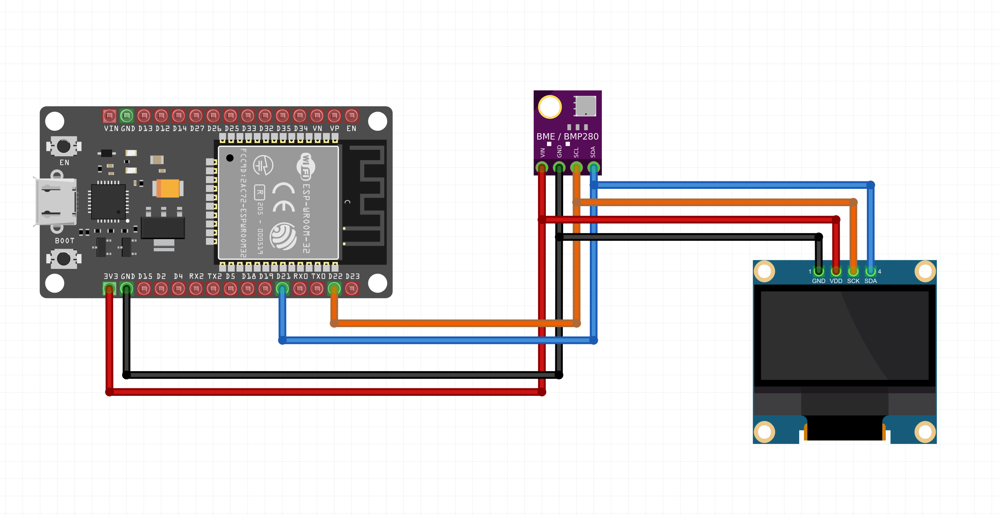
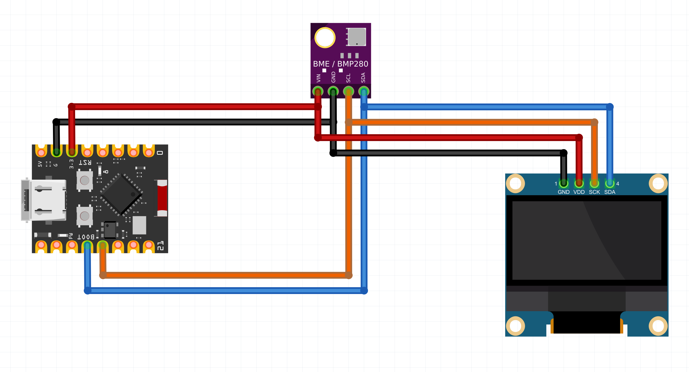
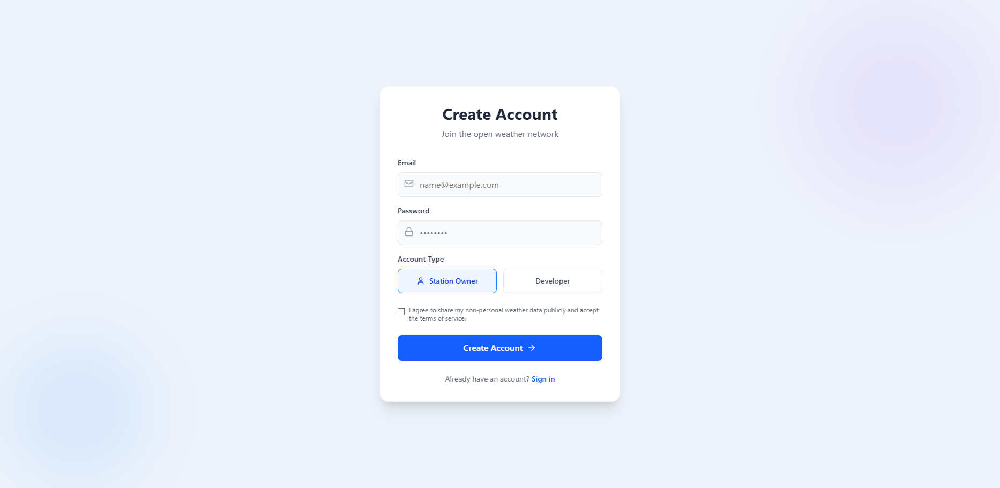
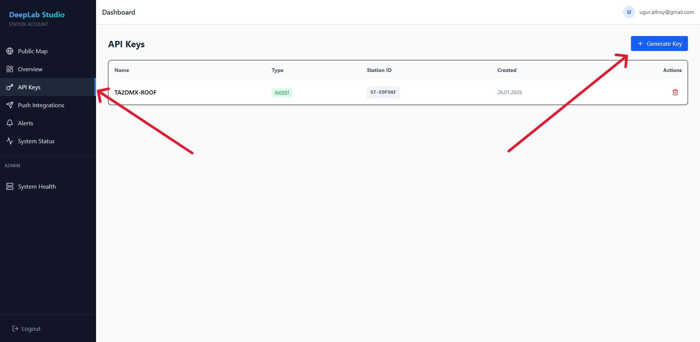
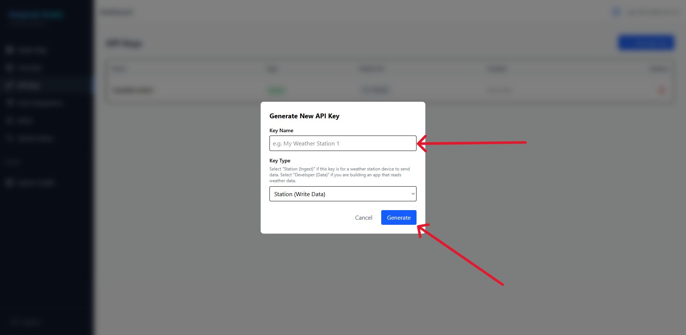
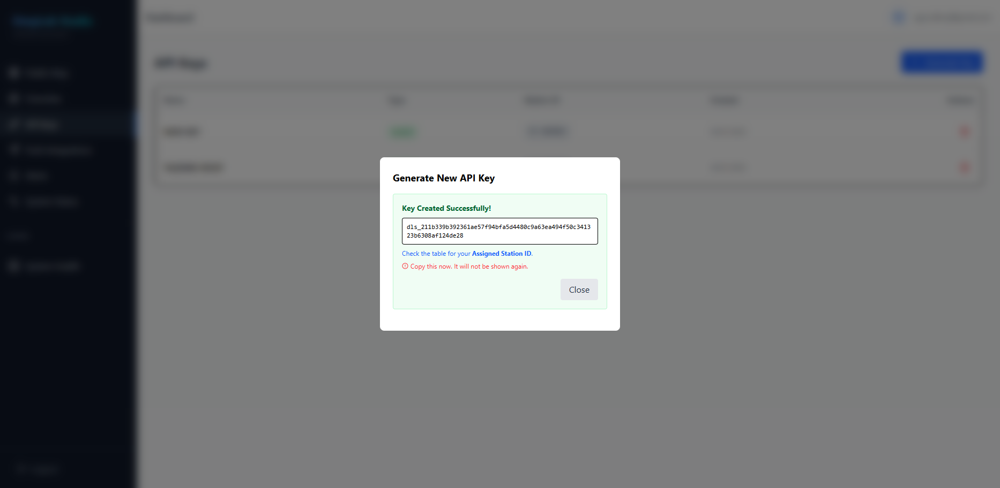
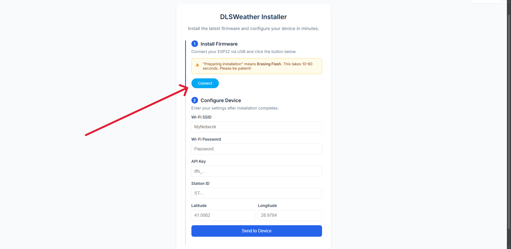
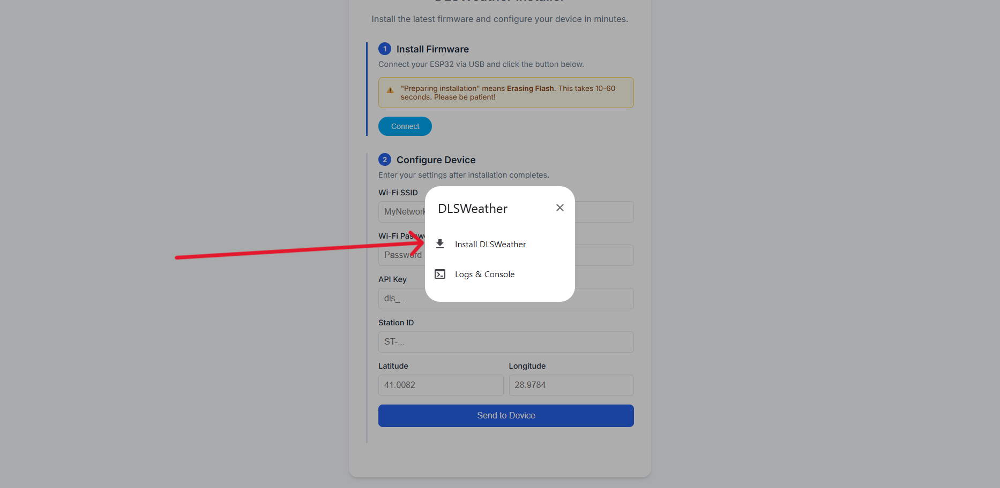
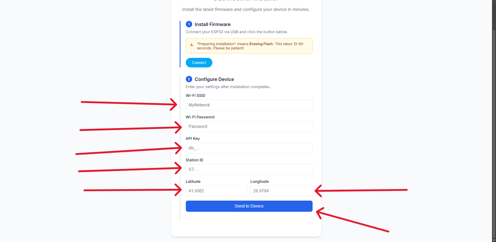

# 🌦️ DLS Weather Node

[](https://github.com/sponsors/Deeplab-Studio)

İngilizce doküman: **[README.md](README.md)**

Bu projenin amacı, **topluluk tarafından işletilen hava durumu istasyonlarının** kurulabilmesini sağlayarak **DLS Weather** girişimini desteklemektir.

Bu servis ile toplanan hava durumu verisi, **tek bir API** üzerinden **5 farklı platforma aynı anda ve ücretsiz** olarak aktarılabilir.

Desteklenen platformlar:

- 📡 **APRS Weather Station** (amatör telsizciler için)
- 🌍 **PWSWeather**
- ☁️ **WeatherCloud**
- 🌡️ **Weather Underground**
- 🌬️ **Windy.com**

Yazılım sürümü tek bir yerde tanımlıdır: [`include/version.h`](include/version.h). Web yükleyici manifestleri de bu değeri okur.

---

## 🔌 Desteklenen Donanım

DLS Weather Node farklı ESP32 kartları, sensörler ve ekranlarla çalışacak şekilde tasarlanmıştır. Aşağıda desteklenen ve test edilen donanım listelenmiştir.

### 📟 Desteklenen Kartlar

| Kart Adı | Çip | Ortam (env) | Notlar |
| :--- | :--- | :--- | :--- |
| **Standart ESP32** | ESP32-WROOM | `esp32_wroom` | Klasik ESP32, tüm özellikler |
| **SuperMini ESP32-C3** | ESP32-C3 | `esp32c3_super_mini` | Önerilen kart (düşük güç, kompakt) |
| **SuperMini ESP32-S2** | ESP32-S2 | `esp32s2_super_mini` | 4 MB flash, dahili USB, rüzgar + yağmur pinleri |
| **SuperMini ESP32-S3** | ESP32-S3 | `esp32s3_super_mini` | 4 MB flash, RGB LED, rüzgar + yağmur pinleri |
| **DevKitC ESP32-S3** | ESP32-S3 | `esp32s3_devkit` | 8 MB flash, daha fazla boş GPIO |

### 🌡️ Desteklenen Sensörler

| Sensör | Tip | Ölçümler |
| :--- | :--- | :--- |
| **BMP280** | I2C | Sıcaklık, Basınç |
| **BME280** | I2C | Sıcaklık, Nem, Basınç |
| **BME680** | I2C | Sıcaklık, Nem, Basınç, Gaz (IAQ) |
| **SHT31** | I2C | Sıcaklık, Nem |
| **SHTC3** | I2C | Sıcaklık, Nem |
| **SHT35** | I2C | Sıcaklık, Nem |
| **VEML6075** | I2C | UV İndeksi |
| **BH1750** | I2C | Işık Seviyesi (planlı) |

Tarama sırası BME680 → SHT3x → SHTC3 → BME280 → BMP280 şeklindedir; ilk cevap veren sensör kullanılır
ve hem seri loga hem cihaz ekranına yazılır. Aynı anda yalnızca bir hava sensörü kullanılır.

### 📺 Desteklenen Ekranlar

| Ekran Kontrolcüsü | Boyut | Arayüz |
| :--- | :--- | :--- |
| **SSD1306** | 0.96" / 1.3" OLED | I2C |
| **SH1106** | 1.3" OLED | I2C |

Ekran bulunamazsa cihaz ekransız (headless) çalışmaya devam eder.

### 🔌 Pin Haritası

| Sinyal | ESP32-WROOM | ESP32-C3 | ESP32-S2 | ESP32-S3 SuperMini | ESP32-S3 DevKitC |
| :--- | :--- | :--- | :--- | :--- | :--- |
| I2C SDA / SCL | 21 / 22 | 8 / 9 | 33 / 35 | 4 / 5 | 8 / 9 |
| Sensör gücü (MOSFET) | 4 | 10 | 18 | 6 | 7 |
| Batarya ADC | 34 | 3 | 1 | 1 | 1 |
| Rüzgar yönü (ADC) | 35 | – | 2 | 2 | 2 |
| Rüzgar hızı (darbe) | 14 | – | 16 | 7 | 3 |
| Yağmur kepçesi (darbe) | 27 | – | 17 | 8 | 4 |
| Durum LED'i | 2 | – | 15 | 48 (WS2812) | 48 (WS2812) |

`ADC_MULTIPLIER` varsayılanı `1.6667`'dir (1 MΩ + 1.5 MΩ bölücü, 3.0–4.2 V Li-ion). Rüzgar/yağmur
pini olmayan kartlarda bu ölçümler ve ilgili ekran sayfaları otomatik olarak atlanır.

### ESP32 Wroom 32



### SuperMini ESP32-C3



---

## 🚀 Derleme ve Yükleme

[PlatformIO](https://platformio.org/) gerekir.

```bash
pio run -e esp32_wroom            # klasik ESP32
pio run -e esp32c3_super_mini     # C3 SuperMini
pio run -e esp32s2_super_mini     # S2 SuperMini
pio run -e esp32s3_super_mini     # S3 SuperMini
pio run -e esp32s3_devkit         # S3 DevKitC-1

pio run -e esp32c3_super_mini -t upload
```

Her derleme sonunda `bootloader.bin`, `partitions.bin` (bölüm tablosunda `otadata` varsa
`boot_app0.bin` de) ve `firmware.bin` dosyaları `docs/firmware/<env>/` altına kopyalanır;
`manifest.json` ve `manifest_update.json` yeniden üretilir.

Tarayıcıdan yükleme: **https://deeplab-studio.github.io/DLS-Weather-Node/**

- **Tam kurulum** – flash'ı siler, sonrasında USB üzerinden ayar yapılır.
- **Sadece güncelle** – `firmware.bin`'i `0x10000` adresine yazar, Wi-Fi/API ayarları korunur.

---

## 🔑 API Anahtarı Alma

### [1️⃣ Adım – Kayıt Ol](https://wx.deeplabstudio.com/register)



### [2️⃣ Adım – API Keys Sayfasına Git](https://wx.deeplabstudio.com/dashboard/api-keys)



### 3️⃣ Adım – Yeni Anahtar Üret

`+ Generate Key` butonuna tıklayın.


### 4️⃣ Adım – Anahtarı Kopyala

Üretilen API anahtarını kopyalayıp güvenli bir yerde saklayın.


---

## [⚙️ DLS Weather Node'u ESP32'ye Kurma](https://deeplab-studio.github.io/DLS-Weather-Node/)

### [1️⃣ Adım – Yükleyiciyi Aç](https://deeplab-studio.github.io/DLS-Weather-Node/)



### 2️⃣ Adım – Bağlan ve Yükle

- **Connect** butonuna tıklayın
- **Install DLSWeather** seçeneğini seçin
  

### 3️⃣ Adım – Ayarları Gir

Kurulum bittikten sonra şunları yapılandırın:

- Wi-Fi bilgileri
- API anahtarı, istasyon ID, koordinatlar
- Sensör ayarları
  

### [4️⃣ Adım – Web Sitesinden Doğrula](https://wx.deeplabstudio.com/)

Cihazınızı web panelinden izleyebilirsiniz.

---

## 🖥️ Cihaz Web Arayüzü

Cihaz Wi-Fi'ye bağlandıktan sonra küçük bir yerel arayüz sunar (internet gerekmez, CDN kullanmaz):

```
http://<cihaz-ip>/
```

- **PIN korumalı.** İlk açılışta 6 haneli bir PIN üretilir, NVS'e yazılır ve OLED açılış ekranında,
  `NETWORK` sayfasında ve seri port açılış logunda gösterilir (`pin` komutu tekrar yazdırır).
- 5 hatalı PIN denemesinden sonra 60 saniye kilit uygulanır; oturum çerezi 12 saat geçerlidir.
- `Host` başlığı doğrulanır ve çapraz kaynaklı `POST` istekleri reddedilir; bu,
  web sayfalarından gelen DNS-rebinding/CSRF denemelerini engeller.
- Sırlar geri yazılmaz: şifre/API anahtarı alanını boş bırakırsanız kayıtlı değer korunur.
- `GET /api/weather` uç noktası şifresiz/PIN'siz açıktır (CORS destekli); yerel sistemler ve betikler doğrudan veri çekebilir.

| Uç nokta | Açıklama |
| :--- | :--- |
| `GET /` | Durum + ayarlar sayfası (PIN korumalı) |
| `POST /save` | Ayarları doğrular, kaydeder ve yeniden başlatır (PIN korumalı) |
| `GET /api/weather` | Son ölçüm JSON verisi (herkese açık, PIN gerektirmez) |
| `GET /api/status` | Yazılım sürümü, çalışma süresi, RSSI, heap, sensör listesi (PIN korumalı) |
| `POST /restart` | Cihazı yeniden başlatır (PIN korumalı) |

### Seri konsol (115200 baud)

| Komut | Etkisi |
| :--- | :--- |
| `GET_CONFIG` | Tüm ayarları JSON olarak yazar (yükleyici bunu kullanır) |
| `GET_CONFIG MASKED` | Aynısı, şifre / API anahtarı / PIN gizli |
| `SET_CONFIG {json}` | Doğrular, kaydeder, yeniden başlatır (`CONFIG_SAVED` veya `VALIDATION_ERROR ...`) |
| `info` | Mevcut ayarları yazar (sırlar gizli) |
| `pin` | Web PIN'ini tekrar yazdırır |
| `restart` | Yeniden başlatır |

Seri porta erişim fiziksel USB erişimi gerektirdiği için güvenilir kanal kabul edilir; ağ üzerinden
erişilebilen yüzey PIN korumalı web arayüzüdür.

---

## ⚡ Güç Davranışı

- **Derin uyku kapalı** – cihaz açık kalır, her *aralık* dakikada bir veri gönderir.
- **Derin uyku açık** – veriyi gönderir, tam bir aralık boyunca uyur. Soğuk açılışta (zamanlayıcı
  uyanışlarında değil) 5 dakikalık bir ayar penceresi açılır, böylece web arayüzüne erişilebilir.
- Hata durumunda 60 saniye arayla 3 kez denenir, sonra bir sonraki aralık beklenir (derin uykuda cihaz
  açık kalmak yerine uykuya döner).
- Günlük yağış toplamı yeniden başlatma ve derin uykudan sonra da korunur (NVS'te saklanır) ve UTC günü
  (NTP epoch günü) değiştiğinde sıfırlanır.
- Batarya voltajı 8 ADC örneğinin ortalamasıdır; yüzde değeri ekran alt bilgisinde ve web arayüzünde
  gösterilir.

---

## 🔗 DLS Weather API'sini Kendi Projelerinizde Kullanma

DLS Weather API'si kendi projelerinize entegrasyon için açıktır.

### API Uç Noktası

```
POST https://wx-api.deeplabstudio.com/v1/ingest/weather
```

### Gerekli Başlıklar

```
Content-Type: application/json
x-api-key: ***
```

### Örnek Gövde

```json
{
  "stationId": "ST-E9F9AF",
  "timestamp": 1769449600,
  "location": {
    "lat": 0.0,
    "lon": 0.0
  },
  "environment": {
    "temperature": 22.5,      // Opsiyonel
    "humidity": 60,           // Opsiyonel
    "pressure": 1013,         // Opsiyonel
    "uv_index": 3.5,          // Opsiyonel
    "air_quality": 45         // Opsiyonel
  },
  "wind": {
    "speed": 5.2,             // Opsiyonel
    "direction": 180          // Opsiyonel
  },
  "rain": {
    "rate": 0,                // Opsiyonel
    "daily": 2.5              // Opsiyonel
  },
  "power": {
    "battery": 85,            // Opsiyonel, yüzde
    "voltage": 4.1,           // Opsiyonel, volt
    "solar": 5.2              // Opsiyonel, volt
  }
}
```

Her bölüm opsiyoneldir; yazılım yalnızca gerçekten ölçtüğü alanları gönderir.

---

## 🔒 Güvenlik Notları

- Ayar arayüzü yerel ağda HTTP üzerinden çalışır. PIN korumalıdır ve güvenlik başlıkları eklenmiştir
  (`CSP`, `nosniff`, `no-referrer`, `no-store`), ancak trafik şifrelenmez — 80. portu internete
  açmayın.
- Her yazma yolunda doğrulama vardır (web formu ve seri JSON aynı kuralları paylaşır): metin
  uzunlukları, `lat`/`lon` aralıkları, istasyon ID karakter kümesi, aralık ve TX gücü beyaz listesi.
- Cihazın hostname'i istasyon ID'sinden `[a-z0-9-]` beyaz listesi ile üretilir.
- **Bilinen sınırlama:** yükleme için kullanılan `DLS-Weather` kütüphanesi
  `WiFiClientSecure::setInsecure()` çağırıyor; yani API anahtarı doğrulanmamış bir TLS bağlantısı
  üzerinden gönderiliyor. Bir sonraki adım olarak o kütüphanede sunucu CA'sının sabitlenmesi
  (`setCACert` / `esp_crt_bundle`) önerilir.
- AP / captive-portal yedeği yoktur: Wi-Fi bilgileri yanlışsa kurtarma USB seri port üzerinden yapılır.

---

## 📁 Depo Yapısı

```
src/
  main.cpp                 zamanlama, sensör okuma, gönderim, derin uyku
  Config/                  NVS ayarları, doğrulama, seri konsol
  Sensor/                  I2C otomatik algılama, rüzgar/yağmur ISR, günlük yağış
  Display/                 OLED sayfaları (olmayan sensörleri atlar)
  NetworkManager/          Wi-Fi, NTP, TX gücü, LED
  WebUI/                   PIN korumalı arayüz + JSON API (HTML PROGMEM'de)
variants/<kart>/           variant.h pin haritası + PlatformIO ortamı
include/version.h          tek yazılım sürümü kaynağı
docs/                      GitHub Pages web yükleyici + hazır binary'ler
```

---

## 🤝 Katkı ve Destek

Bu topluluk odaklı bir projedir. Katkıda bulunabilir, node kurabilir veya DLS Weather ekosistemini
geliştirmek için geri bildirim paylaşabilirsiniz.

📡 **DLS Weather – Topluluk Tarafından Beslenen Hava Durumu Veri Ağı**
